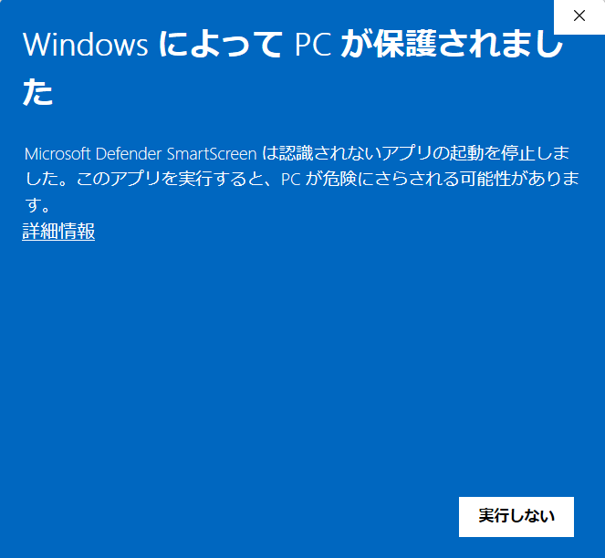
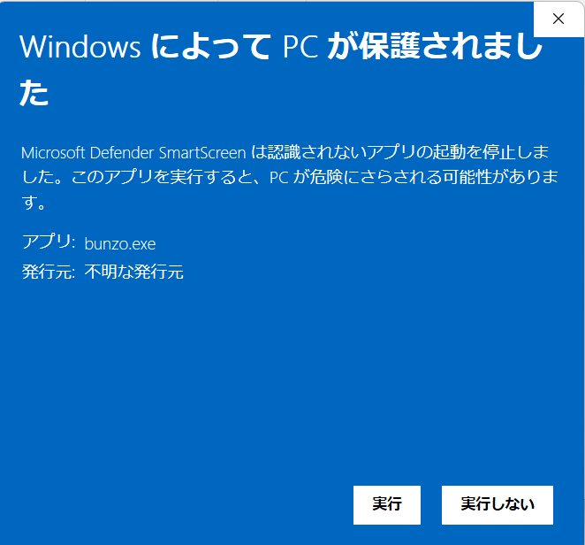

# 筆屋文蔵

**Markdown の記法を調べずに、Markdown を書けるエディタ**です（Windows 11 用・無料）。

- 見出しや太字の記号は画面に出さず、仕上がりの見た目のまま書けます（カーソルのある所だけ記号が見えます）
- 表は表のまま編集できます。ツールバー・メニュー・右クリック・ショートカットで書式を付けられます
- Excel・Word・Web ページからの貼り付けを Markdown にします
- 画像の貼り付け・ドラッグ＆ドロップ、検索・置換、文字数、自動バックアップ
- インストール不要（ZIP を解凍して起動するだけ）。管理者の権限は要りません
- 利用状況の送信や更新の確認などの通信はしません（文書の中にある https の画像だけは、表示するために読み込みます。設定で切れます）

## ダウンロード

[Releases](../../releases/latest) から `fudeya-bunzo-1.0.1-windows-x64.zip` をダウンロードしてください。

| 版 | 1.0.1 |
|---|---|
| 対応 OS | Windows 11（64 ビット） |
| SHA256 | `ed338d8af61fbf8d82b1d443f676fc09ae18befe5e4920597f7ff2042ecde497` |

SHA256 は、PowerShell で次のように確かめられます（表の値と同じなら、ダウンロードしたファイルは配布したものと同じです）。

```powershell
Get-FileHash .\fudeya-bunzo-1.0.1-windows-x64.zip -Algorithm SHA256
```

## 使い始め方

1. ダウンロードした ZIP を右クリックして「すべて展開」を選び、好きな場所に解凍します
2. 解凍したフォルダの `bunzo.exe` をダブルクリックします
3. 初めて起動する時、下の「Windows によって PC が保護されました」の画面が出ることがあります

設定・自動バックアップは `bunzo.exe` と同じフォルダに作られます。やめる時は、フォルダごと削除してください（関連付けを登録した場合は、先に設定画面で解除してください）。

### 「Windows によって PC が保護されました」と出た時

筆屋文蔵には、コード署名をしていません。そのため、初めて起動する時に Windows の SmartScreen がこの画面を出すことがあります。

1. 「詳細情報」を押します

   

2. 「アプリ」が `bunzo.exe`、「発行元」が「不明な発行元」と出ます。［実行］を押します

   

一度［実行］を押せば、同じ `bunzo.exe` を次に起動する時には出ません（ZIP を別の場所に解凍し直した時は、また出ます）。

### .md ファイルをダブルクリックで開くには

1. 筆屋文蔵のメニューの「ファイル」→「設定…」で、「関連付け」の［登録］を押します
2. Windows の「設定」→「アプリ」→「既定のアプリ」で `.md` を探し、「筆屋文蔵」を選びます

## 利用規約

無料でお使いいただけます。無保証です。ZIP の中身を変えず、料金を取らない場合に限り、再配布できます。全文は ZIP の中の `利用規約.txt` にあります（アプリのヘルプ →「バージョン情報」からも読めます）。

本ソフトウェアはオープンソースのソフトウェアではなく、このリポジトリにソースコードは置いていません。含まれているオープンソースのソフトウェアのライセンスは、ZIP の中の `ライセンス表記.txt` に載せています。
